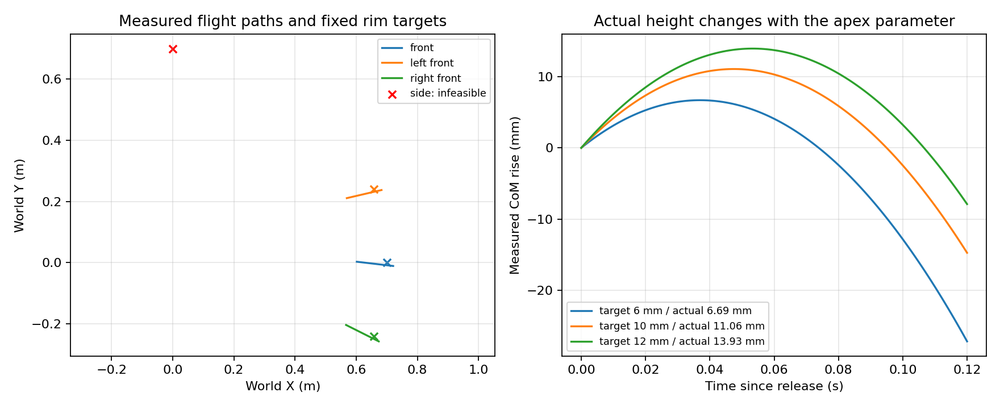

# PiPER 三维目标参数化投掷

2026-10-29；`codex/basketball-long-arc`，沿用 PR #1。

**20 cm 高抛目标尚未实现。** 本轮交付的是可运行、可复现的接触投掷接口，以及三个方向的合规低弧线动作。默认实际上升约 **1.11 cm**；本轮参数验证中的最高合规上升约 **1.39 cm**。不能将它们称为达到 20 cm 的高抛。

## 接口与运行

```python
from piper_throw import throw

result = throw({
    "target_position_m": [0.7, 0.0, -0.5],
    "apex_height_m": 0.01,
    "speed_scale": 1.0,
    "release_phase": 0.5,
}, output_dir="results/my_throw")
```

四项均有默认值。目标是**机器人基坐标系中的桶口中心**：X 前、Y 左、Z 上。基座世界高度 0.75 m，因此这里 Z=−0.5 m 对应世界桶口高度 0.25 m。距离和方向从目标及释放位置推导，不接受另一个 `distance_m` 或 `direction_rad` 输入。

默认桶口距基座水平 0.7 m，但**实际离手点到桶口只有约 0.098 m**，不能写成“投掷了 0.7 m”。

在仓库根目录、Linux/Python 3.12 环境中：

```bash
bash piper_throw/tools/bootstrap.sh  # 首次安装，仍使用原有固定依赖与上游版本
source .venv-piper/bin/activate
MUJOCO_GL=egl python -m piper_throw.cli target-throw \
  --config configs/parametric_throw.yaml --output results/my_throw --video
python -m pytest piper_throw/tests piper_throw/upstream/openarm-control/tests/test_throwing.py -q -o addopts=
```

请使用新的输出目录。左前和右前测试的目标分别为 `[0.7*cos(0.35), ±0.7*sin(0.35), -0.5]`；侧向测试为 `[0, 0.7, -0.5]`。

## 必要改动与根因

- `basketball.py`：复用弹道反算、PiPER Jacobian 和现有 SciPy 确定性搜索，增加 `plan_throw`/`throw`。J2/J3/J5 联动保持夹持俯仰；J1 在准备阶段真实运动到目标方向。所有方向使用同一逻辑，最多进行 5 次物理试投，并依据实测上升高度小范围修正速度。速度修正同时反向缩放时间，保持摆幅不变，避免反馈把制动终点推过关节限位。
- 修正规划初态：原碰撞检查的手指全闭，而执行从 50 mm 开口开始；现在一致。候选先按运动学/力矩可行性排序，避免更低代价的不可行候选挤掉有效动作。沿目标方向检查释放速度和准备距离，不再以世界 X 速度拒绝侧向目标。
- `basketball_controller.py`、`simulator.py`：关节、夹爪指令共用生成函数；采用居中抓取、较缓的准备和计划加速度余量。没有提高位置增益、速度/加速度/力矩限制，没有停用桌面、手指或物体碰撞。
- **释放卸载是真正的控制错误。** 原控制器在开爪命令时立即撤掉名义负载前馈，但盒体约 52 ms 后才脱离。1 ms 下看似通过的动作，在 0.25 ms 下开爪第一步的 J5 达 5.664 rad/s²。现在名义负载在这段开爪时间内平滑卸载，规划与仿真共用该模型。同一关节轨迹的 0.25 ms 对照中，释放窗口 J5 峰值降至约 3.016，全程峰值约 3.618 rad/s²，成功入桶。未删帧、未改实际加速度判定、未设置自由物体速度。
- `cli.py`、`__init__.py`：增加入口；新增 `configs/parametric_throw.yaml` 和真实 MuJoCo 回归测试。复用 OpenArm 的参数化与仿真反馈思路，没有照搬其七轴索引、速度预算、weld 或额外无限重力补偿。

## 实测结果

同一个 100 g 盒体、相同几何、质量、夹爪及关节物理限制。所有成功均要求真实接触脱离、先升后降、无物理约束违规、未触发 gross-slip，并最终完整低速留桶。

| 测试 | 目标/参数 | 实际结果 |
|---|---|---|
| 前方 | 基座系 `[0.7,0,-0.5]` | 合规入桶，约 1.11 cm 上升 |
| 左前 | 方向 +0.35 rad | 合规入桶；实际释放朝左前 |
| 右前 | 方向 −0.35 rad | 合规入桶；实际释放朝右前 |
| 左侧 | `[0,0.7,-0.5]` | 本预算内不可行；没有中断后续试验 |
| 改近目标 | X 从 0.70 改为 0.68 m | 实际释放速度和桶口穿越位置均变化，合规入桶 |
| 改上升高度 | 目标 6 / 10 / 12 mm | 实际约 6.69 / 11.06 / 13.93 mm，均合规入桶 |
| 原始高抛要求 | `[0.8,0,-0.5]`、上升 0.20 m | 未找到可执行候选，正常返回 `infeasible` |

左侧不是通过旋转视频得到的结果。将同一前方动作的 J1 转向 +Y 做物理诊断时，蓄力盒体中心约位于世界 `(0,0.36,0.68)` m，与 0.75 m 桌面发生约 5 cm 穿透，实际积分报告桌面碰撞及超限。规划器拒绝这种动作；没有移动桌面或放宽关节限制。此结果只针对当前场景、轨迹族与有限预算，不证明 PiPER 的所有侧向动作都不可行。

默认轨迹在 1 ms 下实际最大速度约 2.50 rad/s、最大加速度约 3.62 rad/s²、最大位置跟踪误差约 0.00392 rad；J2 峰值力矩约 10.49 N·m，J5 约 2.67 N·m。仍使用六轴 3 rad/s、5 rad/s²、力矩 `[12,12,12,3,3,3]` N·m。

预开爪平移漂移约 **15.3 mm**，低于原有 20 mm gross-slip 阈值，但不是刚性无滑动夹持。这个漂移和夹爪横向释放偏差均保留在原始记录中，不能称为已完成真机夹持标定。

固定动作重复 **3/3** 入桶，释放状态和落点完全一致。执行器增益、摩擦和释放延迟的三次扰动 **3/3** 合规入桶；`speed_scale=0.99/1.01`、`release_phase=0.495/0.505` 的四次参数扰动 **4/4** 合规入桶。确定性重复不作为统计鲁棒性证据；这些小样本结果也不代表整个参数域都可行。

原有 25 项及新增 6 项真实实现回归，共 **31 项通过（236.26 s）**。新增回归覆盖三方向实际运动、目标/高度对真实飞行的影响、侧向碰撞、不可行结果、公共轨迹导出及 0.25 ms 卸载回归。另建独立虚拟环境按原 `requirements.lock` 安装，`pip check` 与默认实际试投均通过，没有增加依赖。原始上游资产仍由既有 bootstrap 固定版本提供。

## 迁移边界与证据

`commands.npz` 导出 `time_s`、六轴 `joints_rad`、关节速度/加速度、**双指总开口** `gripper_opening_m` 和开爪时刻。仿真使用相同生成函数；未来可接既有 `TrajectorySink.execute(time_s, joints_rad, gripper_opening_m)`。已核对固定版本 pyAgxArm 的六轴弧度接口；**`real_piper.py` 未修改，硬件执行仍禁用，没有导入/初始化 SDK、连接 CAN 或发送运动。** MuJoCo 伺服响应与实际固件响应尚未等价验证。

未解决的限制包括：当前轨迹族未实现 20 cm 上升；该侧向目标受桌面/准备姿态约束；5 rad/s² 与保守力矩预算未实物标定；指垫摩擦、柔顺性、52 ms 名义卸载时间及真实执行器响应均需辨识。细步长仍会改变接触和毫米级落点，不能声称已完成 Sim-to-Real。

旧实验和报告保留。完整每次输入、失败候选、控制 CSV、模型 XML 与回放 NPZ 保留在服务器 `results/parametric_throw_20261029/`；Git 仅提交精简证据。

- [逐次实测汇总](results/parametric_throw_20261029/release_transfer_verified/summary.json) · [自动测试 XML](results/parametric_throw_20261029/release_transfer_tests.xml)
- [默认低弧线视频](results/parametric_throw_20261029/release_transfer_verified/default_low_arc.mp4) · [修复前失败高弧线视频（明确未达标）](results/parametric_throw_20261029/failed_high_arc.mp4)
- [距离、高度、方向的实际轨迹图](results/parametric_throw_20261029/release_transfer_verified/parameter_effects.png) · [公共轨迹导出](results/parametric_throw_20261029/release_transfer_verified/front/commands.npz)


