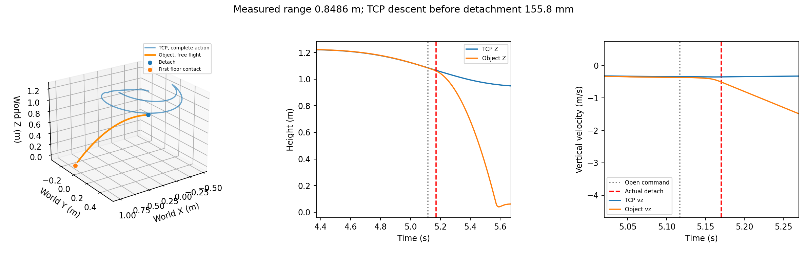
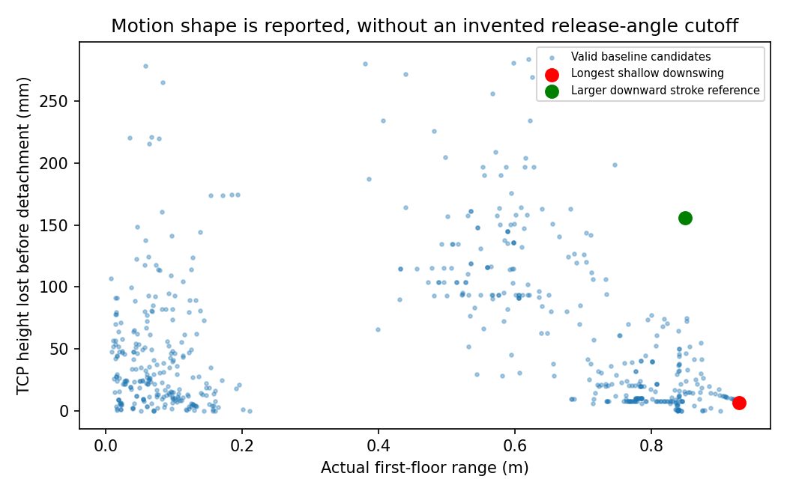
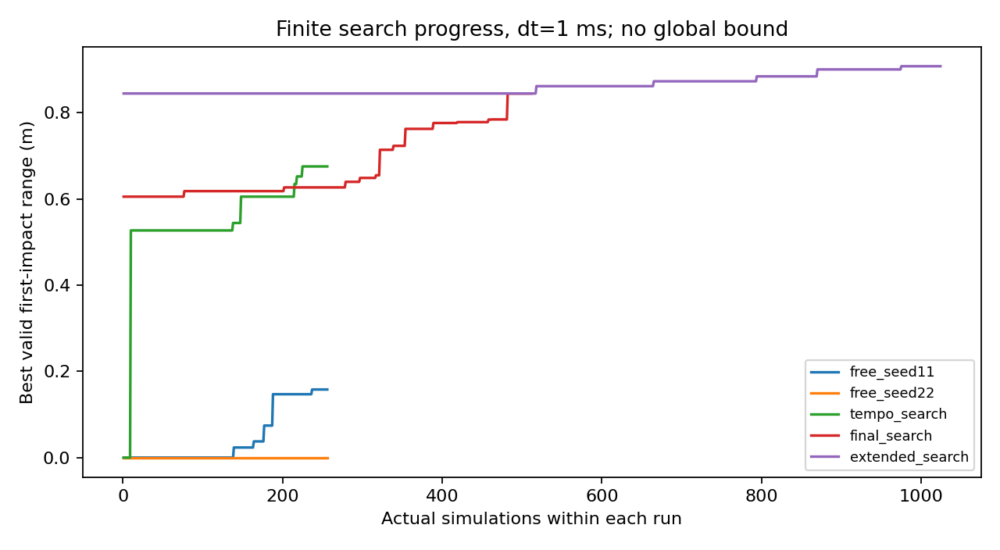
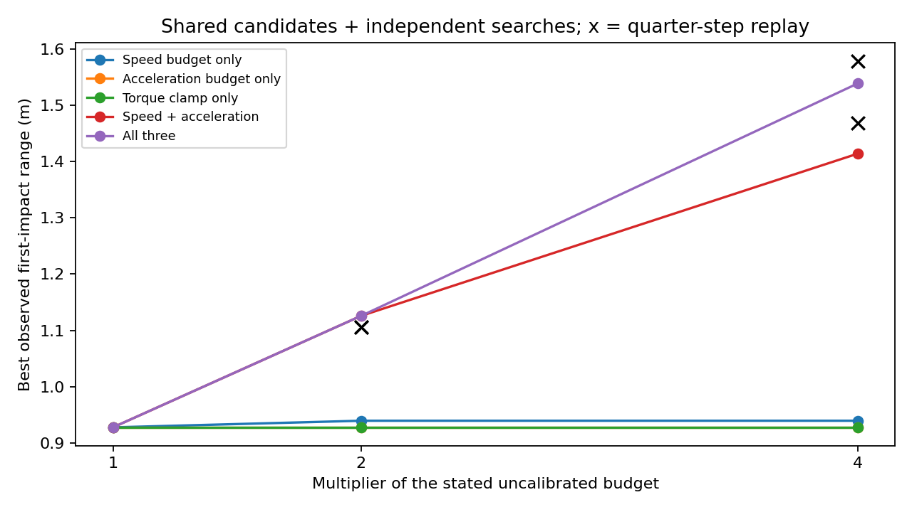
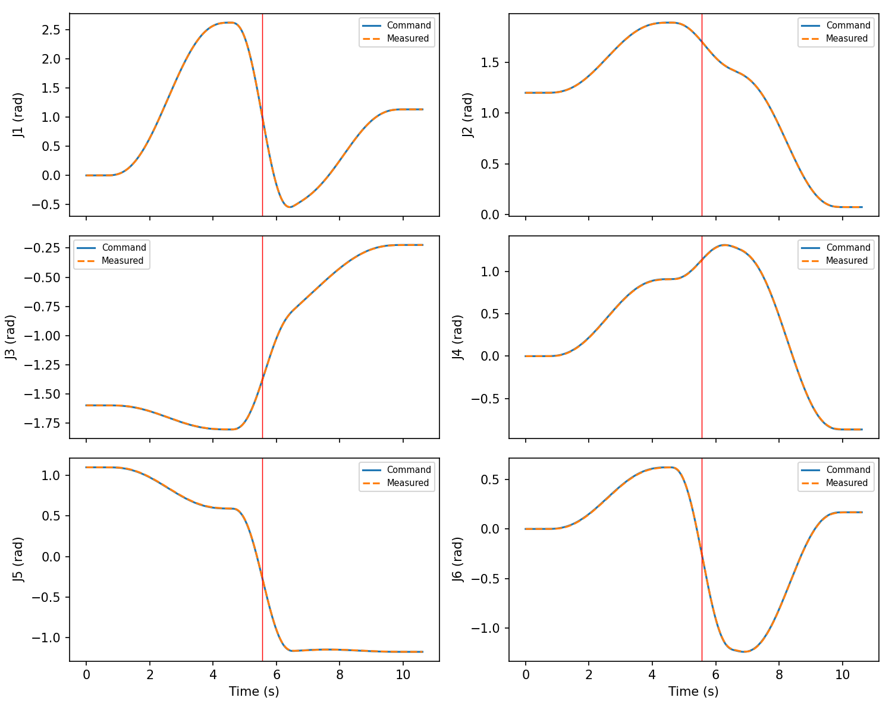

# PiPER 向下挥摆测距实验（2026-10-29）

本轮范围：真实 MuJoCo 接触投掷、固定桌面/基座/地面、最大首次落地投距。旧报告、旧实验及投篮入口保留；未连接硬件、CAN，未修改真机保护。

## 实测结论与动作形态

| 动作 | 1 ms投距 | 0.25 ms复核 | 0.125 ms复核 | 离手前TCP下降 | 离手时TCP vz |
|---|---:|---:|---:|---:|---:|
| 明显下挥代表（视频首选） | 0.8486 m | 0.8572 m | 0.8579 m | 155.8 mm | -0.351 m/s |
| 最长浅下挥候选 | 0.9277 m | 0.9350 m | 0.9359 m | 7.0 mm | -0.056 m/s |

**不能把最长浅下挥候选宣传成明显劈落式动作的最大投距。** 优化偏向横向扫摆、浅下行释放。没有自行规定最低释放角度或下降高度；上述两条来自同一控制器、同一对象、同一预算。明显下挥代表取自已搜索候选的投距—下降量前沿，属于更符合动作外观的代表，并非额外角度门槛下的全局最优。

明显下挥的TCP在挥摆中从约1.223 m下降到1.067 m，物体以负竖直速度离手，随后直接下落；主要朝右前方，六关节共同运动。最长候选则以横向扫摆为主。

- [明显下挥视频](data/range_20261029/clear_downstroke/throw.mp4)、[输入/动作参数](data/range_20261029/clear_downstroke/inputs.json)、[真实轨迹](data/range_20261029/clear_downstroke/trajectory.csv)、[控制/力矩](data/range_20261029/clear_downstroke/control.csv)。
- [最长浅下挥视频](data/range_20261029/selected_nominal/throw.mp4)、[输入/动作参数](data/range_20261029/selected_nominal/inputs.json)、[真实轨迹](data/range_20261029/selected_nominal/trajectory.csv)。




## 场景与计量

载入模型实际值：[scene_audit.json](data/range_20261029/scene_audit.json)。地面 **Z=0**，桌面 **Z=0.750 m**、桌底 **Z=0.700 m**；基座原点/底面 **Z=0.750 m**，基座碰撞网格上缘约 **0.836 m**。桌面1.10×0.90 m，中心X=−0.45 m，尺寸与位置未变。

沿用100 g、120×80×50 mm隐藏配重盒、CoM=[0,0,0]及原物理一致惯量。物体geom摩擦=[0.8,0.01,0.001]，夹爪geom摩擦=[1,0.005,0.0001]，solref=[0.02,1]；夹爪执行器20 N、开爪命令100 ms均沿用模型。没有改变这些参数来增加投距。

测距场景独立设置 `include_bucket: false`。复放确认：旧API默认桶(0.7,0,0)不截断这两条动作；底层场景默认桶(0.8,0,0)分别在5.513 s、5.942 s截断明显/浅下挥的飞行，所以不能把这些桶碰撞后的运动计入自由投距。见[bucket_checks.json](data/range_20261029/bucket_checks.json)。

指标是**实际离手几何原点至首次floor接触点的水平距离**；同一步多个首次接触点取几何平均，并保存全部接触点。还保存物体中心在首次接触时的水平位移。离手取已建立抓取后首次无机器人接触的样本；随后先碰机器人、桌面或桶，立即记录为受阻飞行，不将碰撞后的运动计为投距。采样精度为该次积分步长。

| 1 ms实测量 | 明显下挥 | 最长浅下挥 |
|---|---:|---:|
| 开爪命令时刻 | 5.117 s | 5.508 s |
| 真正脱离时刻 | 5.170 s | 5.562 s |
| 开爪至脱离延迟 | 53.0 ms | 54.0 ms |
| 离手高度（距地面） | 1.0629 m | 1.0890 m |
| 飞行时间 | 0.4010 s | 0.4370 s |
| 物体离手线速度模长 | 2.1142 m/s | 2.0580 m/s |
| 中心到首次接触时中心的位移 | 0.8230 m | 0.8956 m |
| 开爪前最大相对抓取漂移 | 34.6 mm | 34.2 mm |

浅下挥离手位置为[0.3574,0.4225,1.0890] m；首次接触点[1.0589,−0.1846,约0] m。基座到落点的距离及落地滚动均不作为投距。检查持续到机器人制动结束后再保持既有settle_time=0.6 s，不要求物体落地低速停留。

## 改动及验证到的原因

- `range_throw.py`：一套六轴三段五次曲线，联合搜索自由起摆、挥摆末端位置/速度、独立制动位置及三个时长、释放相位和时间尺度。六轴均可动，不设俯仰联动。29维有限动作族，准备结束时静止；没有穷举任意多段运动。
- `throw_controller.py`只增加该动作族分发；`simulator.py`复用原动力学积分、有限力矩补偿、真实夹爪接触，增加首次落地计量、TCP释放状态及障碍分类。
- `scene/build.py`只增加可选移除桶；`visualize.py`支持无桶场景和真实测距标注。视频为保存的MuJoCo qpos回放，摄像机从实际飞行侧面观察，不改动物体轨迹。
- 首轮发现65点采样会漏掉五次曲线的命令加速度极值，改用导数多项式根计算峰值再进行时间缩放。仅有1e−9浮点比较epsilon，没有物理预算容差。
- 静止掉落曾被极小负vz误判为下挥；现在要求存在运动命令、TCP实际下行且低于本挥摆此前最高点。无最小角度/高度阈值。
- 较早0.8446 m候选在0.25 ms时J1于挥摆后半段减速达到5.010 rad/s²，[保留失败结果](data/range_20261029/512_check_quarter/result.json)，未忽略帧或提高门限。当前两条交付动作在更小步长均通过。

开爪、接触和滑动仍会影响结果。最长浅下挥的TCP速度为[1.3396,−1.2999,−0.0565] m/s，物体为[1.5577,−1.3318,−0.1879] m/s，二者不能混用；角速度[−1.8566,−0.2631,−4.3763] rad/s。开爪前漂移约34 mm，保留20 mm gross-slip诊断但不据此伪装为未投出；接触几何审计显示指尖接触持续到5.561 s，5.562 s真正脱离。没有weld夹持或自由物体速度注入。

全相位复放的早释放例：5.525 s离手，5.583 s撞回link7指尖，已超过100 ms开爪命令结束时刻，属于真实再碰撞。晚释放例：5.947 s提前滑出，开爪命令在5.965 s才到。失败结果正常保存并继续批量实验。见[早释放失败](data/range_20261029/release_failures/early/result.json)、[晚释放失败](data/range_20261029/release_failures/late/result.json)。

## 搜索与人为限制消融

共保存 **4,752** 条真实积分候选索引，另有重复、场景和小步长复核；FK初值筛选不计为投掷仿真。多初值逐步从64/256扩大到512，再追加1024次；512次阶段最好0.8446 m，1024次阶段0.9079 m，再扫描释放相位得到0.9277 m。后期仍有改善，**没有证明搜索收敛或全局上限**。

单项/组合消融把旧限制投影到同一新动作族，固定种子33、每项96次；是有限预算对照，并非原投篮程序性能或全局因果效应。

| 对照 | 合规最好投距(m) |
|---|---:|
| 全部旧式限制 | 0.1324 |
| 仅去掉0.6加速度预留 | 0.1559 |
| 仅去掉0.04 rad额外余量 | 0.1313 |
| 仅开放J1挥摆 | 0.1913 |
| 仅开放J4/J6 | 未找到（96次） |
| 仅去掉J2/J3/J5定俯仰联动 | 0.1386 |
| 仅去掉对称路径/时长 | 0.1644 |
| 同时开放J4/J6与俯仰 | 0.1328 |
| 同时去掉预留与对称路径 | 0.2108 |

本轮单项改善最大的是开放J1（+58.9 mm）；预留与对称路径同时去除增加78.4 mm。0.04 rad额外余量未显示收益；J4/J6单独开放未找到合规解，不代表已证明不可行。全部解除后的长搜索不能与96次单项结果当作同预算因果比较。

1.5倍上升高度偏置和桶口/滞留目标已从新入口删除：本任务没有高度目标，无法对该乘数做有物理含义的距离消融。旧入口的0.96速度缩放也未继承，但没有单独归因它的收益。



## 预算来源、实际用量与能力扫描

[固定版本AgileX SDK CHANGELOG](https://raw.githubusercontent.com/agilexrobotics/piper_sdk/b847e5393a7ce6ff8508d713eca7bdd3a42421b4/CHANGELOG.MD)规定的是0–3 rad/s、0–5 rad/s²的**设置范围**，不是本轮验证过的物理上限。

| 参数 | 当前基线 | 来源与含义 |
|---|---|---|
| 关节行程 | 见scene_audit；J3下限−2.697 rad | 原MuJoCo模型与SDK范围交集，非本轮实测 |
| 速度 | 六轴3 rad/s | SDK设置范围作为实验预算，未标定硬件最大速度 |
| 加速度 | 六轴5 rad/s² | 参考SDK设置范围选取的未标定预算 |
| 力矩 | [12,12,12,3,3,3] N·m | 项目人工模型假设，非厂家连续/峰值额定值 |
| 执行器响应 | kp=[250,250,250,80,80,80]，kv=[18,18,18,7,7,7] | 原模型参数；armature=0.005、damping=0.4、frictionloss=0.3，未实物辨识 |
| 夹爪/接触 | 20 N、100 ms及上述摩擦/接触参数 | 原模型假设，未做实物夹持力/开爪/摩擦标定 |

v/a预算用于规划和完整轨迹合规判定，没有把实际qvel/qacc硬裁剪。补偿通过同一有限力矩actuator；约束冲量仍计入实际加速度。下表为整段动作峰值，含初始化、释放、减速和制动。

| 关节 | 明显下挥v(rad/s) | a(rad/s²) | τ(N·m) | 浅下挥v | a | τ |
|---|---:|---:|---:|---:|---:|---:|
| J1 | 2.995 | 4.926 | 2.901 | 2.989 | 4.878 | 2.864 |
| J2 | 0.733 | 0.702 | 9.265 | 0.681 | 0.592 | 10.086 |
| J3 | 1.015 | 1.501 | 6.020 | 0.843 | 1.195 | 6.177 |
| J4 | 1.355 | 1.290 | 1.684 | 1.126 | 1.221 | 1.610 |
| J5 | 1.591 | 2.457 | 2.012 | 1.612 | 2.442 | 1.894 |
| J6 | 1.742 | 2.675 | 0.917 | 1.648 | 2.451 | 0.876 |

最长浅下挥J1速度2.989接近3预算，峰值加速度4.878接近5；执行器饱和步数均0，J2最大力矩10.086小于12。相同轨迹快1%已触发速度超限。没有证据把这个结果归因为真机力矩不够。

独立配置保持对象、桌/基座/地面、增益和夹爪不变，扫描未标定预算的1/2/4倍。候选池包含各配置128次独立搜索、共享的基线动作及99次成对时长复放和边界复核；表内是该有限池最好值。共享基线动作的力矩上界未激活，放宽预算不改变其物理执行。

| 放宽项目 | ×2最好(1 ms) | ×4最好(1 ms) | 对应×4动作0.25 ms |
|---|---:|---:|---:|
| 仅速度 | 0.9395 | 0.9395 | — |
| 仅加速度 | 0.9277 | 0.9277 | — |
| 仅力矩 | 0.9277 | 0.9277 | — |
| 速度+加速度、原力矩 | 1.1258 | 1.4139 | 1.4679 |
| 三项一起 | 1.1258 | 1.5386 | 1.5789 |

单独增加速度预算的边界复核增加约11.8 mm；该共同动作需要同时增加v/a预算才能大幅增加投距，更快动作再放宽力矩可进一步改善。不是“仅换一个硬件参数就保证提升”的实机结论。×4三项是v=12 rad/s、a=20 rad/s²、τ=[48,48,48,12,12,12] N·m的纯仿真假设；0.125 ms得1.5958 m，仍有步长敏感性，不作为精确极限。独立搜索另一个1.2204 m动作在0.25 ms下J5达到24.660>20，[已标为不合规](data/range_20261029/capability4_quarter/result.json)；未挑选性忽略。

对主视频的同一明显下挥关节路径单独复放：v/a×2、原力矩得到1.1210 m；v/a×4、原力矩得到1.3642 m；三项×4得到1.4303 m，TCP下降仍约160 mm。0.25 ms复核分别得到1.4227 m（v/a×4、原力矩）、1.5176 m（三项×4），均合规，但高速接触释放仍有明显步长敏感性；这些数值不是稳定精确上限。它们与浅下挥最好值分开记录，详见[边界与明显下挥能力复放](data/range_20261029/capability_boundary.json)。



## 重复、测试及复现

明显下挥固定参数重复3/3合规，投距完全一致；既有2.5%增益、4 ms延迟、5%摩擦扰动假设下3/3合规，范围0.8482–0.8503 m。浅下挥重复3/3一致；同类扰动3/3合规，0.9271–0.9306 m。这是确定性及小样本模型扰动，不代表真机重复性。

保留原31项测试，新增4项真实实现回归：场景不变且无weld、六轴轨迹连续、首次落地计量/静止掉落排除、真实自由飞行重力加速度。最终全量35项测试通过，输出见[pytest_final.txt](data/range_20261029/pytest_final.txt)。



在服务器仓库根目录（或检出此分支、按原requirements.lock安装后的环境）：

```bash
source .venv-piper/bin/activate
python -m piper_throw.range_throw \
  --config data/range_20261029/clear_downstroke/config.yaml \
  --replay data/range_20261029/clear_downstroke/inputs.json \
  --output results/downstroke_replay_new
MUJOCO_GL=egl python -c "from piper_throw.visualize import render_video; render_video('results/downstroke_replay_new', view='panorama', annotate=True)"
python -m pytest piper_throw/tests piper_throw/upstream/openarm-control/tests/test_throwing.py -q
```

将replay/config改为`selected_nominal`可重放最长浅下挥；改为`clear_downstroke_quarter`可重放0.25 ms；0.125 ms使用相应动作目录下的`step_0p125ms.yaml`。新output目录必须不存在。重新搜索可运行：

```bash
OPENBLAS_NUM_THREADS=1 OMP_NUM_THREADS=1 python -m piper_throw.range_throw \
  --config configs/range_throw.yaml --seed 88 --workers 8 --budget 1024 \
  --warm data/range_20261029/search_seeds.json --output results/range_search_new
```

所有候选的参数、释放状态、违例和来源保存在[evaluations.jsonl.gz](data/range_20261029/evaluations.jsonl.gz)，配置映射在[experiment_configs.json](data/range_20261029/experiment_configs.json)。历史开发阶段的诊断分类可能与最终版本不同（pilot静止掉落已剔除出结论）；实际交付动作均由最终实现重新执行。逐条动作重放是复现依据，不承诺跨版本搜索过程逐项相同。

原始完整试验保留在服务器`data/range_20261029/`；版本控制只收录交付轨迹、关键复核、图表和压缩索引，未覆盖旧结果。源码/运行版本哈希见[source_manifest.json](data/range_20261029/source_manifest.json)。本轮没有新增实物测量；行程/速度/加速度可用范围、力矩—速度曲线、执行器响应、关节惯量/摩擦以及夹爪力/摩擦/开爪时序仍须辨识。不能报告Sim-to-Real能力或无界执行器的有限最大投距。
