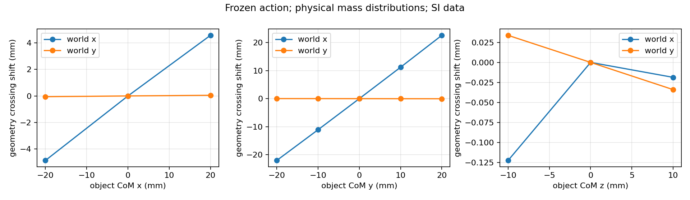

# CoMass

PiPER 六轴机械臂 MuJoCo 投掷、自动参数搜索、三维质心敏感性与 Hidden-Mass Object Benchmark。纯仿真，不连接真实机械臂；没有强化学习或神经网络训练。

- [实验报告与已知局限](piper_throw/REPORT.md)
- [安装、命令行、坐标系及接口说明](piper_throw/README.md)
- [上游代码审计与固定提交](piper_throw/UPSTREAM_AUDIT.md)
- [固定依赖](piper_throw/requirements.lock) / [第三方许可证](piper_throw/THIRD_PARTY_NOTICES.md)

## 已测结果

核心测试 9/9、OpenArm 原始投掷测试 5/5。严格前向上抛的盒体动作在 20 次扰动中 19 次最终留桶；45 个可实现 CoM 配置在冻结动作下最大桶口落点分离 54.07 mm。一般摆臂的同一高敏感动作在夹爪接触释放测试中 80/80 留桶，四种内部配重的最大平均落点分离 62.55 mm。

上述数字属于不同实验协议。严格上抛的接触释放尚未对全部配重稳定成功；有限预算优化残差、仿真假设与失败结果都保留在报告中。结果不代表已经完成真实 Sim-to-Real。



[最佳上抛动作视频](results/upward_box_best/throw.mp4) · [同一敏感动作的接触释放视频](results/hidden_sensitive_contact_transfer/throw.mp4) · [最佳上抛参数](results/upward_final_optimization/best_params.json)

## 快速运行

需要 Linux、Python 3.12 与 Git；无头视频可使用 EGL。当前验证版本为 MuJoCo 3.8.1。

```bash
git clone https://github.com/rangeryx-66/CoMass.git
cd CoMass
bash piper_throw/tools/bootstrap.sh
source .venv-piper/bin/activate
python -m pytest piper_throw/tests -q
python -m pytest piper_throw/upstream/openarm-control/tests/test_throwing.py -q
python -m piper_throw.cli throw --config configs/upward_box.yaml --video
```

bootstrap 下载三个固定提交的上游仓库及经 SHA256 校验的 PiPER STL。

## 交付范围

仓库以代码与报告为主，保留报告引用的少量汇总 CSV/JSON、图表、演示视频、最佳参数及测试记录。完整逐步轨迹、5,772 次正式试投的输入/结果记录、预试验与原始数据保留在本地，不上传 GitHub。

上游源码和模型通过 bootstrap 按固定提交下载；不提交虚拟环境或 SDK 运行连接。所有报告结论均来自实际 MuJoCo 仿真，未修改实验数值。
