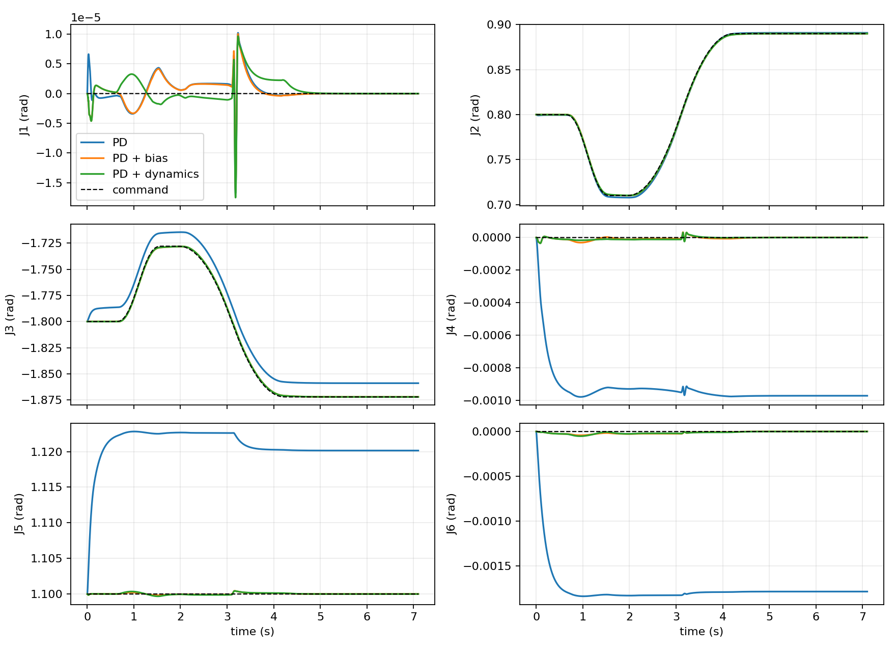

# PiPER 仿真修复与验证

2026-10-28；服务器 `labserver_inschool`；分支 `codex/basketball-long-arc`。起点为 `289c26e` 加已有未提交改动。只运行 MuJoCo，没有接入真机。

**结论：M1–M3 通过；M4 未找到合规高抛；M5 按阶段要求未执行。** 低速控制和接触释放已得到实际验证，高速投掷的力矩饱和、滑动仍未解决。没有提高速度、加速度、力矩或滑动容差，也没有删除瞬态帧。

## 观察、根因与修改

1. **静止开爪也触发加速度门限。** 旧夹爪位置阶跃在无物体接触的 ideal 工况中，使 J4 在释放阶段达到 6.263 rad/s²；当时关节力矩仅 0.066 N·m，没有饱和。这是手指运动的惯性反作用，不能解释为机械臂投掷能力不足。保留并验证现场已有的 0.10 s 平滑开合：同一旧抓取/姿态的静止 ideal 峰值降至 0.111 rad/s²。没有放宽 5 rad/s² 检查。
2. **基础 PD 初态不满足重力平衡。** 旧姿态关闭偏置补偿时，首个 1 ms 的 J3 加速度为 25.581 rad/s²，命令加速度为零、执行器力矩为零。这是未平衡重力的动力学响应，保留为失败对照。带受限补偿的 A–E 不再出现该问题。
3. **动力学前馈不完整。** 补上模型已有粘性阻力的补偿，以及名义负载点的 `J̇q̇` 加速度项。控制器仍只使用名义 100 g 点负载，不读取隐藏 CoM 或扰动后的执行器增益。保持旧抓取和姿态做前后对照时，低速接触摆臂的最大跟踪误差由 0.001809 降至 0.001626 rad；完整投掷仍失败，不能声称前馈修好了力矩不足。
4. **抓取几何造成非预期掌部接触。** 旧盒体初态与 link6 穿入约 2 mm，静止夹持后仍接触掌部，释放角速度约 6.70 rad/s。仅移出初始穿透，闭爪沉降后仍会触掌；夹爪朝上时，脱离后又可能落回掌部。将工具系抓取 z 从 0.105 改为 0.115 m，并将准备姿态 J5 从 0.5 改为 1.1 rad，使夹爪近水平。保留 x=0.025 m 的偏心抓取、原始指垫、摩擦和所有碰撞。静止释放角速度降至 0.082 rad/s，无再次碰臂；未用 weld 替代接触。
5. **轨迹末端多积分一步。** 原循环在末采样后还执行一次 `mj_step`，使最终状态比回放末时刻多 1 ms。修正为末采样只记录状态；实际积分步数、最终状态和 CSV/NPZ 时刻一致。积分后的跟踪误差继续与下一时刻命令比较；CSV 同时保存施加命令和对齐后的目标，没有通过错移索引缩小误差。
6. **正常的候选不可行导致程序崩溃。** 0.5 m 实测复现：力矩筛选淘汰全部候选后，反馈阶段访问 `reference['params']`，触发 `TypeError`。现在记录该距离无可行候选并继续扫描；全扫描无动作时，CLI 正常返回，不再调用依赖已选动作的后处理。名义逆动力学需求进入规划代价，涵盖准备、摆臂、制动、粘性/Coulomb 摩擦和名义点负载；不再仅按运动学残差选完候选后才检查力矩。该估计以 50 ms 采样，最终可执行性仍须真实积分验证。

保留有用的阶段加速度、饱和、接触力和控制 CSV；没有新增依赖、异常体系或控制框架。移除现场已删除的近期 CI 工作流，本次验证使用现有 pytest/CLI。`rise_targets` 的真实搜索范围及单值目标也经真实规划回归验证。

## M1–M3 实测

下表为最终配置的 contact 工况；A/C 不附加载荷。静止和低速诊断仅关闭高抛目标，所有关节物理门限保持不变。ideal 对照的 A–E 也全部无违规。

| 工况 | 峰值实际加速度 rad/s² | 最大关节跟踪误差 rad | 饱和/提前滑动 | 结果 |
|---|---:|---:|---|---|
| A 静止空载 | 0.118 | 0.000064 | 无/无 | 通过 |
| B 静止持物 | 1.335 | 0.000502 | 无/无 | 通过 |
| C 低速单关节空载 | 0.592 | 0.001215 | 无/无 | 通过 |
| D 低速单关节持物 | 1.335 | 0.001217 | 无/无 | 通过 |
| E 低速多关节持物 | 1.790 | 0.001663 | 无/无 | 通过 |
| F 旧完整投掷动作 | 14.078 | 0.191318 | J2 饱和/有 | 未通过 |

相同 E 轨迹、相同最终抓取位姿的控制对照：

| 控制 | 峰值加速度 rad/s² | 最大跟踪误差 rad |
|---|---:|---:|
| 位置 PD + 目标速度项 | 24.832 | 0.022825 |
| 加偏置补偿（重力/Coriolis、名义负载重力） | 1.791 | 0.001841 |
| 再加动力学前馈 | 1.790 | 0.001663 |



E 的预开爪最大平移漂移为 4.84 mm；20 mm gross-slip 指标保持不变，只在开爪命令之前判提前滑动。持物阶段指垫总法向力约 7.28–7.29 N；开爪后约 52 ms 脱离，随后持续 20 ms 无接触才确认，释放状态取最初脱离时刻。两次无扰动重复的释放状态完全相同。

种子 10/11/12 的三次增益、摩擦和时延扰动试验全部无违规、无提前滑动、无再次碰臂；最大漂移 5.04 mm。释放速度各轴标准差为 [0.000110, 0.000240, 0.003151] m/s，仅说明这三次小样本的重复性。0.5 ms 步长复核也无违规；相对 1 ms 的释放位置差 0.067 mm、线速度差 0.000746 m/s、角速度差 0.0263 rad/s，实际释放时刻一致。接触数值误差不是零。

完整 F 动作的 J2 在 3.003–3.475 s 的 12 N·m 限幅附近累计饱和 473 个 1 ms 步。首次超限是 3.014 s 的 J3：命令 −4.275、实际 −5.035 rad/s²，当时 J3 力矩 −3.729 N·m，J2 已饱和。最大加速度发生在随后制动的 3.557 s：J2 命令 4.275、实际 14.078 rad/s²，当时力矩 5.640 N·m，已经退出饱和。耦合跟踪误差及制动追赶仍需保留，不能只检查饱和当帧。提前漂移达 48.9 mm。这与静止夹爪阶跃、无补偿初态属于不同故障来源，不能通过同一容差掩盖。

证据：[最终诊断](results/simulation_fix/validated_20261028/diagnostics.json)、[前馈修正前](results/simulation_fix/verified_before_20261028/diagnostics.json)、[保持旧抓取的前馈修正后](results/simulation_fix/verified_after_20261028/diagnostics.json)、[扰动及半步长结果](results/simulation_fix/m3_repeats_20261028/summary.json)。

## M4：短距离负结果

对 0.5/0.8/1.0 m 共执行 660 次数值规划评估，每个距离保留 10 个候选，没有找到同时通过运动学高抛要求和名义力矩检查的候选；三距离扫描正常完成。最优代价候选的速度残差分别为 0.566/0.872/1.212 m/s。默认扫描范围已收敛为这三个短距离。

为检查拒绝是否与真实积分一致，另做 7 次接触诊断：三个候选各一次释放点测量和一次固定桶位置距离复核，再复核一次旧高抛动作。以下距离均按实测离手点到桶口中心计算；桶在积分开始前固定，没有设置自由物体速度。

| 动作 | 实测距离 m | 离手后上升 m | 峰值实际加速度 rad/s² | 主要失败 |
|---|---:|---:|---:|---|
| 0.5 m 候选 | 0.500 | 0.225 | 7.975 | 提前滑动、加速度超限、再次碰臂 |
| 0.8 m 候选 | 0.800 | 0.222 | 8.490 | 提前滑动、加速度超限、再次碰臂 |
| 1.0 m 候选 | 1.000 | 0.197 | 6.929 | 提前滑动、加速度超限、上升不足、竖直释放速度不足、再次碰臂 |
| 旧高抛动作诊断 | 0.500 | 0.256 | 14.078 | 提前滑动、加速度及跟踪超限 |

这是真实先升后降的仿真诊断，不是合规动作。接触滑动和碰撞会改变实际释放状态，出现较高弧线不代表规划轨迹被正确执行。**M4 未通过，不执行 M5，不发布新的 CoM 敏感性结论。** 旧 80/80 留桶及 114.2 mm 分离数据保持原样，仍属不合规动作诊断。

证据：[扫描配置](results/simulation_fix/short_arc_final_20261028/config.json)、[三距离扫描](results/simulation_fix/short_arc_final_20261028/scan.json)、[真实试投诊断](results/simulation_fix/short_arc_final_20261028/physical_diagnostics.json)。所有逐步 CSV/XML/NPZ、抓取对照及失败记录保留在服务器原目录；Git 仅保存精简证据。

## 测试与复现

原有核心及 OpenArm 测试，加上真实 MuJoCo 夹爪、末时刻、接触初态、确定性释放和无可行候选继续扫描的回归：**25 项通过，62.64 s**。[测试 XML](results/simulation_fix/reviewed_tests_20261028.xml)。没有用 mock 替代新增物理回归，也没有新增 CI。

```bash
source .venv-piper/bin/activate
python -m pytest piper_throw/tests piper_throw/upstream/openarm-control/tests/test_throwing.py -q -o addopts=
python -m piper_throw.cli diagnose-sim --config configs/basketball_throw.yaml --output results/simulation_fix/new_diagnostics
python -m piper_throw.cli basketball --config results/simulation_fix/short_arc_final_20261028/config.json --output results/simulation_fix/new_short_arc --repeats 0
```

这两条 CLI 使用新输出目录；短距离配置保存的是实际执行过的有限预算。精简证据中的 trial `inputs.json` 可直接作为 `throw --config` 输入重跑。程序错误继续暴露异常；未命中、滑动、超限和无候选均保留为正常实验失败。

## 未解决的物理模型问题

- 5 rad/s²、[12,12,12,3,3,3] N·m、PD 响应、关节摩擦/阻尼、上游连杆与夹爪惯量均缺乏当前实物标定。F 的饱和是真实的模型内结果，不能直接等同于真实 PiPER 的硬件极限。
- 指垫柔顺性、摩擦、法向力与命令开度的映射、实际开爪时延需辨识；高速下的 20 mm 以上提前滑动尚未修复。更大搜索预算不能替代这些证据。
- 前馈及规划力矩使用名义点负载，未包含真实盒体的完整转动惯量；50 ms 力矩采样也不构成连续时间可执行性证明。控制器未获得隐藏质量分布。
- 当前仍从给定位姿开始夹持，不包含桌面拾取。没有验证真机安全性或 Sim-to-Real 成功。
