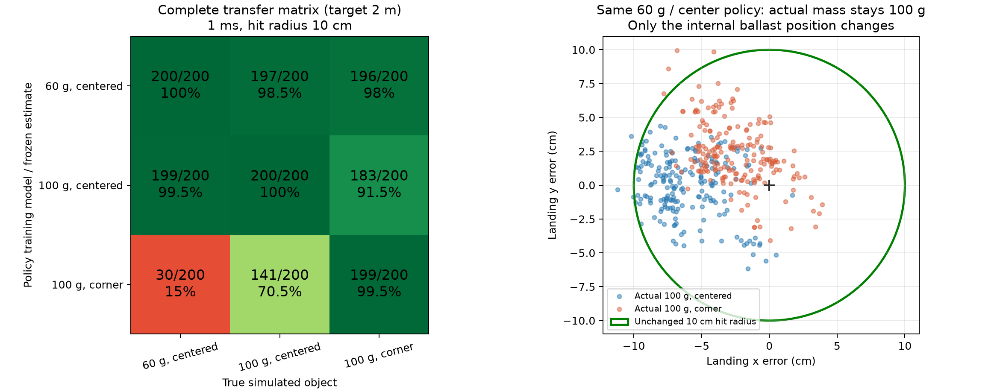

# 2 m 目标：同一配重盒体的远投与参数交叉测试

目标改为机械臂基座坐标 **[2, 0, 0] m**。100 g 角落配重策略在独立的 **200 回合、1 ms** 测试中命中 **199/200（99.5%）**，平均首次落地误差 **5.30 cm**，从最终脱离机械臂到落地的实际质心水平位移平均 **1.57 m**。距离基座 2 m 不等于在空中飞行 2 m。

[实际远投视频](verification/identification_2m/video/correct_throw.mp4) 使用测试集的第一个初始条件 **seed 60000**，命中误差 **6.77 cm**，实际自由飞行 **1.58 m**。包含正常速度和明确标注的 0.25 倍慢放，视频标明 1 ms 物理步长、50 Hz 控制频率及 10 cm 命中半径。[同初始条件四组对比视频](verification/identification_2m/video/comparison.mp4) 保留参数错配也命中的实例。四条录制轨迹与正式评估的 `episode_000.npz` 逐元素一致。

**步长敏感性尚未解决：**正确角落策略在 0.5 ms 为 **30/30**，在 2 ms 为 **0/30**。本轮没有执行真机，也没有运行 VLM/Delta。以下报告同时保留成功、参数迁移反例和数值敏感性。

## 相同物体和判定条件

与 1 m 实验相同的 60 × 50 × 70 mm 盒体、1 mm 壳体、固定内部长方体配重。三种模型分别为 60 g 居中、100 g 居中、100 g 角落；角落模型总质心为相对几何中心 **[15.2, 11.2, 17.6] mm**，完整惯量按有限尺寸配重与空心壳体计算。

初始抓持、摩擦、夹爪、关节/执行器范围、八维动作和 `action_rate` 不变；七个初始关节设定仍各有均匀 ±0.005 rad 扰动。首次地面接触点评分，命中半径仍为 **10 cm**，没有添加轨迹、角度或速度限制。几何、质量、质心及目标在每个专家的训练中固定，没有启用模仿奖励。这是三个固定物体、固定 2 m 目标的专家，并非已验证覆盖任意落点的通用策略。

相对 1 m 配置，环境只改目标位置和距离塑形参数：`reward.distance_scale` 从 0.3 m 调为 1 m，以提供远距离训练梯度。塑形范围不参与最终命中判定。实际物理参数和策略输入的估计参数仍分离，交叉测试始终冻结策略自己的质量/质心/惯量估计，物体速度使用几何原点速度加估计质心换算，不提供隐藏的真实质心速度。

## 训练和模型选择

原来的三个 1 m 策略直接在 2 m 自有模型各测 30 回合，均为 **0/30**。随后进行了以下训练，全部过程记录在 `verification/identification_2m/training/`：

1. 各自的 1 m 策略继续约 26.2 万步。角落模型学会远投，两组居中模型仍明显偏近。
2. 尝试从已有 `followup/checkpoints/far.pt` 的 2 m 投掷技能继续训练。该技能原先使用更小的盒体，直接迁移时新的固定几何/惯量特征超出旧归一化统计，表现退化。三个未校准分支已停止，日志保留。
3. 只对**新训练物体**的静态特征初始化归一化统计：观测下标 `[32,138)` 的质量、质心、惯量及物体系表面点均值设为新训练物体的固定值，方差设为零；其余统计、计数、actor 权重均不变。`initialize_object.py` 可复现该初始化。未经后续训练的自有模型误差约 20–22 cm；再分别进行 **196608 步 PPO**，学习率 0.0002，全部动作仍由网络输出。

这项校准仅用于训练初始化；**不在测试新物理模型时重新校准**。每个专家的固定参数经过其自身归一化后为常量，策略差异通过在对应物理模型内的 RL 训练形成；不是在测试时给网络新参数并要求即时适应。预训练 checkpoint 保存的随机状态被恢复，训练环境 seed 为 2026。

验证种子为 **50000–50049**，最终测试为 **60000–60199**。先在每个专家自己的物理模型筛选直接续训、校准远投续训的 best/last，再用 50 回合自有模型验证选模型。100 g 居中 best/last 只达到 39/50、45/50，因此额外检查了该分支的保存快照，仍只使用自有模型验证。最终三份模型都为 **50/50**，随后全部冻结，再开始交叉评估。没有按错配后的失败率挑模型。

| 最终模型 | checkpoint 累计采样步数 | 自有模型验证平均误差 |
|---|---:|---:|
| `center_060.pt` | 865152 | 4.98 cm |
| `center_100.pt` | 782208 | 2.84 cm |
| `corner_100.pt` | 732288 | 5.48 cm |

步数包含已有远投预训练；不是三个从零训练的独立试验。完整来源、选择记录及 SHA256 见 `protocol.json`，初始化 checkpoint 也已保存。

## 1 ms 完整交叉矩阵

每格 **200 回合**，同一批目标与初始关节设定配对；括号为平均落点误差，单位 cm。权重、归一化统计与估计参数在测试中不更新。

| 策略训练参数／冻结估计 | 实际 60 g 居中 | 实际 100 g 居中 | 实际 100 g 角落 |
|---|---:|---:|---:|
| 60 g 居中 | **200/200 (4.65)** | **197/200 (6.64)** | **196/200 (4.29)** |
| 100 g 居中 | **199/200 (5.74)** | **200/200 (3.01)** | **183/200 (6.90)** |
| 100 g 角落 | **30/200 (11.33)** | **141/200 (8.19)** | **199/200 (5.30)** |



全部 1800 回合都从双侧手指接触开始，最终释放并落地，无超时；各格实际自由飞行距离均值约 **1.55–1.61 m**。

这次 **60 g 居中策略到 100 g 角落仍有 98% 命中**，没有复现 1 m 实验的 1.5%。100 g 居中策略到角落为 91.5%，正确角落策略为 99.5%；反方向角落策略到 60 g 居中只有 15%。参数敏感性具有策略和方向依赖，不能将“更远”直接等同于“错误参数必然失败”。本轮不支持将 VLM 居中猜测失败作为稳定结论，也不能把已知的正确参数称作 Delta 的实测估计。

## 物理步长与进一步诊断

所有步长都保持 **50 Hz** 策略频率。0.5 / 2 ms 各使用前 30 个测试种子，冻结与主测试相同的 checkpoint：

| 策略在自有模型 | 0.5 ms，30 回合 | 1 ms，200 回合 | 2 ms，30 回合 |
|---|---:|---:|---:|
| 60 g 居中 | 30/30 | 200/200 | 1/30 |
| 100 g 居中 | 30/30 | 200/200 | 23/30 |
| 100 g 角落 | 30/30 | 199/200 | 0/30 |

完整九格结果位于 `evaluation/half_ms/table.json` 和 `evaluation/two_ms/table.json`。正确角落策略在 2 ms 的平均误差为 **19.06 cm**，不能用 1 ms 的 99.5% 声称跨步长稳健。

又对正确角落模型的 seed 60000 做 2 / 1 / 0.5 / 0.25 ms 逐物理步诊断：

- 闭环下误差依次为 **20.52 / 6.77 / 6.05 / 2.97 cm**。
- 固定同一套 2 ms 动作，并使用同一份 0.25 ms 沉降后的初始 qpos/qvel，2 与 1 ms 的落点仍相差 **18.15 cm**。所以反馈动作和初始化差异不足以解释全部偏差。
- 同动作、共同初始状态下，2 ms 最后接触的是右手指垫，1 ms 是左手指垫；释放速度分别约 `[4.231, -1.996, -0.067]` 与 `[4.152, -1.699, -0.116]` m/s。
- 最后一段无机械臂接触的弹道最大残差分别只有 **6.21 / 1.94 mm**，远小于落点差。证据主要指向持物、指垫接触与释放阶段的数值积分差异，而非仅仅自由飞行积分或控制频率改变。

逐步接触名称、状态、控制量与动作保存在 `step_diagnosis/traces.zip`。该诊断进一步定位了问题，尚未修复敏感性，也未证明细步长完全收敛。没有调整摩擦、原生执行器或命中规则来消除失败。

## 复现

以下在仓库根目录执行，需已安装本模块及依赖：

```bash
# 将已有远投技能初始化为一个固定训练物体，然后继续 PPO
python -m xarm7_rl.initialize_object \
  --checkpoint xarm7_rl/verification/followup/checkpoints/far.pt \
  --config xarm7_rl/configs/identification_2m/warm_corner_100.yaml \
  --output runs/my_initial_corner.pt
python -m xarm7_rl.train \
  --config xarm7_rl/configs/identification_2m/calibrated_corner_100.yaml \
  --resume runs/my_initial_corner.pt --reset-best

# 直接复核已冻结的三份策略：200 回合完整矩阵
python -m xarm7_rl.cross_parameters \
  --policy center_060:xarm7_rl/verification/identification_2m/checkpoints/center_060.pt \
  --policy center_100:xarm7_rl/verification/identification_2m/checkpoints/center_100.pt \
  --policy corner_100:xarm7_rl/verification/identification_2m/checkpoints/corner_100.pt \
  --case center_060:xarm7_rl/configs/identification_2m/center_060.yaml \
  --case center_100:xarm7_rl/configs/identification_2m/center_100.yaml \
  --case corner_100:xarm7_rl/configs/identification_2m/corner_100.yaml \
  --episodes 200 --seed 60000 --timesteps .001 --output runs/transfer_2m_test

python -m xarm7_rl.film_parameters --results runs/transfer_2m_test \
  --checkpoints xarm7_rl/verification/identification_2m/checkpoints --output runs/transfer_2m_video
python -m pytest xarm7_rl/tests -q
```

0.5 / 2 ms 复核使用同一命令，改为 `--episodes 30 --timesteps .0005` 或 `.002`。`diagnose_steps` 使用正确角落 checkpoint、对应配置和 `--seed 60000` 可复现逐步诊断。24 项测试通过，包括静态统计校准不改变运行状态统计的测试。本地 CPU、MuJoCo 3.17 / PyTorch 2.15；该案例仍需多训练种子及真机验证。
