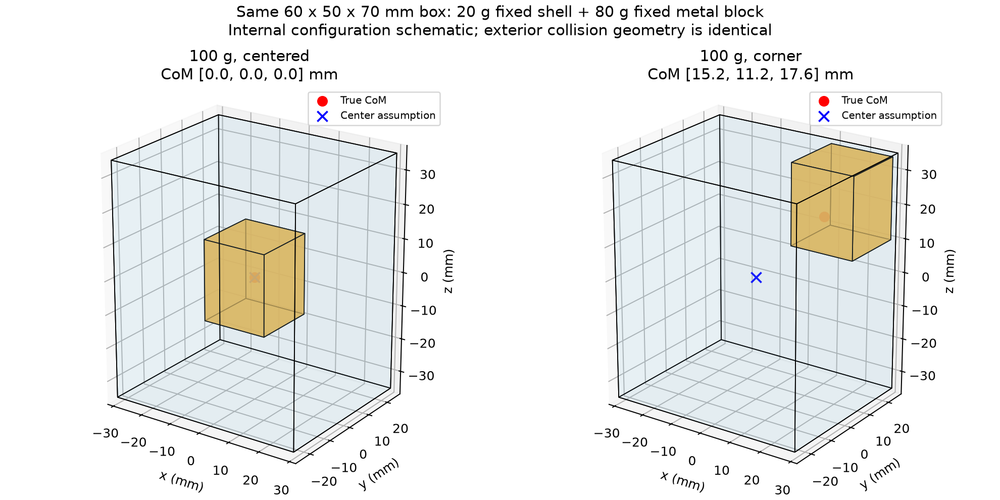
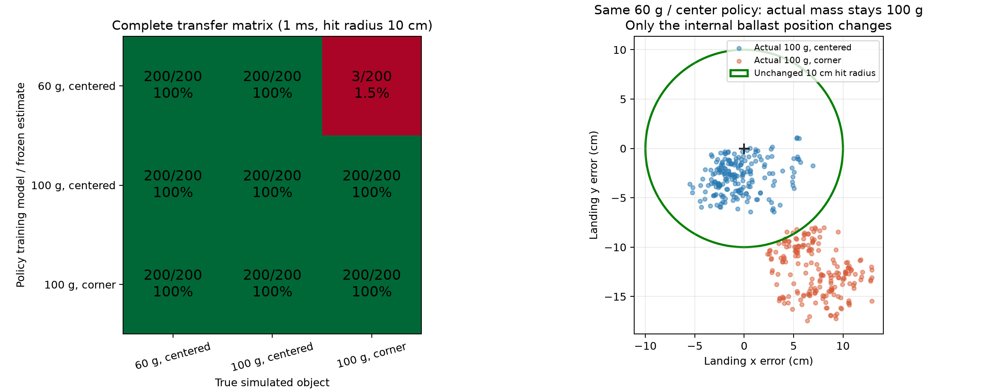

# 角落配重盒体：训练参数与部署参数错配实验

本轮得到了一组明确的参数错配结果：在 60 g、居中质心模型训练的 PPO 策略，自有模型测试为 **200/200**；保持网络、归一化统计和参数估计输入不变，换到 100 g、角落配重模型后为 **3/200**。在角落配重模型重新训练的策略达到 **200/200**。完整矩阵也显示：另一个在 100 g、居中质心模型训练的策略，换到角落配重后仍为 **200/200**。因此，这是一组参数错配导致迁移失败的实例，尚不能证明质量正确时仅凭质心偏移就必然失败。

这里的“部署物体”仍是第二个仿真模型，没有执行真机投掷，也没有调用 VLM 或 Delta；居中估计是预设的错误假设，正确参数来自已知的刚体构造。本轮先验证实验链条，未测量实际物体识别精度。

## 物体和固定条件

使用同一个 **60 × 50 × 70 mm** 盒体外形，1 mm 均匀壳体质量 20 g，内部刚性固定一个 **20 × 20 × 24 mm** 配重块。没有内部滑动或晃动物体。`ballast.py` 按空心壳体、有限尺寸长方体和完整平行轴定理计算总质量、质心及关于总质心的六项惯量；角落不是无限小点配重。

| 配置 | 总质量 | 配重质量 | 配重中心，相对盒体几何中心 | 总质心，相对盒体几何中心 |
|---|---:|---:|---|---|
| `center_060` | 60 g | 40 g | [0, 0, 0] mm | [0, 0, 0] mm |
| `center_100` | 100 g | 80 g | [0, 0, 0] mm | [0, 0, 0] mm |
| `corner_100` | 100 g | 80 g | [19, 14, 22] mm | [15.2, 11.2, 17.6] mm |

总质心偏移约 **25.8 mm**。80 g 配重密度为 8.33 g/cm³，尺寸和位置能够装入壳体。真机可采用固定金属配重，但实际壳体、固定材料的质量和坐标仍需实测后写入配置；这些尺寸不是用户现有物体的测量值。



三组使用相同 xArm7 与原生夹爪资产、初始关节设定、抓持位姿、摩擦、奖励和动作映射。目标是基座坐标 **[1, 0, 0] m**，首次地面接触点距目标不超过 **10 cm** 才记为命中。没有扩大半径，没有新增关节、挥摆路径、速度或出手角度限制。关闭模仿奖励和质量/质心/几何/目标随机化。

每回合七个初始关节设定各有独立均匀 **±0.005 rad** 扰动；同一个测试种子的设定在全部策略和物理模型之间配对。随后进行原生夹爪接触沉降，真实初始状态可随物理参数改变。200 次不是同一个确定性初始状态重复播放。该测试只覆盖这一个目标和很小的初始姿态变化，不代表广泛目标或几何泛化。

## 训练、选择及防止真实参数泄漏

三组 PPO 都从头训练，初始化种子为 2026，各完成 **262272** 个采样步；物理步长 1 ms，控制周期 20 ms（50 Hz），CPU/3 个环境。训练日志和完整配置保存在 `verification/identification/training/`。

验证种子为 30000–30049，最终测试种子为 40000–40199。只根据**自有物理模型**选择 checkpoint，选择后冻结，再开始交叉测试。60 g 居中、100 g 角落使用后期自有模型验证通过的训练窗口 best；100 g 居中的训练窗口 best 在确定性验证中只有 4/50，因此对保存快照先用 10 个自有模型验证回合筛选，再对前三个做 50 回合验证，最终选择 last。该调整没有查看交叉失败率；完整早/晚验证和筛选记录都保留。三份最终模型自有模型验证均为 50/50。

| 冻结策略 | 采样步数 | checkpoint SHA256 |
|---|---:|---|
| `center_060.pt` | 248448 | `e8c90d3d76ff08a6e38ba545c300aee01b1b5570b3a575d1ce1f34a181a38511` |
| `center_100.pt` | 262272 | `5f5390edd46fd119e5c46605ddd78c33582650fdb32b8c4d3d1b699576742532` |
| `corner_100.pt` | 259200 | `9e38c319769cf90886289b92da857d11a4a8ee8fb9bd2354248801817f1c9e6f` |

新增可选 `env.inertial_estimate`，将**物理引擎使用的参数**与**策略相信的参数**分开。每个策略始终接收其训练模型的质量、质心和惯量；换物体时不向它提供新的真值。几何原点线速度由 `mj_objectVelocity(..., mjOBJ_XBODY, ...)` 获取，再用该策略的估计质心换算为估计质心速度，避免直接把真实偏移质心的速度送入策略。单元测试验证：保持相同几何位姿和原点速度，只改变真实质心，完整观测不变；也覆盖旋转姿态与非零估计质心。

策略仍具有关节和夹爪状态、物体位姿/速度反馈，并非开环动作回放；换参数导致的运动变化可以被反馈感知。物体位姿/速度目前由仿真直接提供，真机需要相应状态估计。塑形奖励使用仿真物理真值，只用于训练，不作为测试时策略输入；测试中没有梯度更新或归一化更新。不配置 `inertial_estimate` 时保留原有环境行为和观测维度。

## 完整结果

每格 **200 回合**，同一批初始关节扰动，1 ms。括号内是平均首次接触点误差，单位 cm。

| 策略训练参数／冻结估计 | 实际 60 g 居中 | 实际 100 g 居中 | 实际 100 g 角落 |
|---|---:|---:|---:|
| 60 g 居中 | **200/200 (4.12)** | **200/200 (3.84)** | **3/200 (14.55)** |
| 100 g 居中 | **200/200 (1.32)** | **200/200 (2.93)** | **200/200 (5.34)** |
| 100 g 角落 | **200/200 (1.45)** | **200/200 (1.88)** | **200/200 (2.96)** |

全部 1800 回合都以双侧手指接触开始，并发生了最终释放和实际落地；没有超时、未夹住物体或未释放导致的失败。最终离开机械臂到落地的实际质心水平位移，九格均值范围为 **0.43–0.58 m**。目标距基座 1 m，不等于飞行距离 1 m。



结果支持以下具体解释：

- 错误 60 g 居中模型可以在自己的仿真里成功，却在目标角落配重物体上失效；按目标物体正确参数重训可以恢复命中。这符合用户想演示的“自己的仿真成功不等于参数错配后成功”。
- 同一个 60 g 策略换到 **100 g 居中**仍成功，再把同一个 80 g 配重移到角落就降为 1.5%。在这个策略上，仅总质量改变不足以解释失败，内部质量分布的改变有实际影响。
- 但 **100 g 居中策略**也能适应角落配重。因此目前没有建立“质量已准确时，额外准确质心估计一定提升命中率”的证据。不能只展示失败的一行并隐去这个反例。
- 移动有限尺寸配重同时改变质心及惯量，故该实验测试的是惯性参数／质量分布错配；不能将差异全部归因于单独的质心坐标。

这些是三个单种子训练实例的实测成功率，未对多个训练随机种子做总体推断。

## 步长复核与视频

冻结相同三份模型，50 Hz 控制不变，换成 **0.5 ms** 物理步长，对全部九格各测前 30 个测试种子。60 g 居中策略到角落配重为 **0/30**、平均误差 **15.63 cm**；其自有模型为 **30/30**，正确角落策略自有模型为 **30/30**；其余格也全部 30/30。关键对比在更细步长仍存在，但这不等于已证明接触积分完全收敛。完整表保存在 `evaluation/half_ms/table.json`。

[实际仿真投掷四格视频](verification/identification/video/comparison.mp4) 包含正常速度和标明的 0.25 倍慢放。固定使用最终测试第一回合 **seed 40000**，没有挑失败种子。四格依次为：

1. 60 g 居中策略在自有模型：命中，误差 **1.98 cm**。
2. 同一策略在 100 g 角落模型：未命中，误差 **16.11 cm**。
3. 正确角落参数策略在角落模型：命中，误差 **2.07 cm**。
4. 100 g 居中策略在角落模型：命中，误差 **4.76 cm**，保留稳健反例。

录制只修改相机；四条视频轨迹均与正式评估的 `episode_000.npz` **逐元素完全一致**，断言和结果保存在视频 manifest 中。各回合结束后画面暂停到落地位置，未继续模拟反弹滚动；没有添加物体速度、外力或位置修正。

## 复现与记录

安装模块测试依赖；图表另需 `pip install -e 'xarm7_rl[plot]'`。以下命令在仓库根目录执行：

```bash
# 三个固定物体分别从头训练；每个调用独立输出目录
python -m xarm7_rl.train --config xarm7_rl/configs/identification/center_060.yaml
python -m xarm7_rl.train --config xarm7_rl/configs/identification/center_100.yaml
python -m xarm7_rl.train --config xarm7_rl/configs/identification/corner_100.yaml

# 使用已冻结的实测 checkpoint 重现完整测试
python -m xarm7_rl.cross_parameters \
  --policy center_060:xarm7_rl/verification/identification/checkpoints/center_060.pt \
  --policy center_100:xarm7_rl/verification/identification/checkpoints/center_100.pt \
  --policy corner_100:xarm7_rl/verification/identification/checkpoints/corner_100.pt \
  --case center_060:xarm7_rl/configs/identification/center_060.yaml \
  --case center_100:xarm7_rl/configs/identification/center_100.yaml \
  --case corner_100:xarm7_rl/configs/identification/corner_100.yaml \
  --episodes 200 --seed 40000 --timesteps .001 --output runs/transfer_test

# 将上面的 episodes 改为 30、timesteps 改为 .0005，可复核更细步长
python -m xarm7_rl.film_parameters --results runs/transfer_test \
  --checkpoints xarm7_rl/verification/identification/checkpoints --output runs/transfer_video
python -m xarm7_rl.plot_parameters --results runs/transfer_test --output runs/transfer_figures
python -m pytest xarm7_rl/tests -q
```

`self_select.py` 提供自有模型验证筛选，不读取交叉测试结果。所归档的 `protocol.json` 记录对象构造、训练/验证/测试种子、选择原则及冻结哈希；`evaluation/` 保留两种步长全部逐回合 JSON、汇总和轨迹 ZIP；`training/` 保留配置、完整指标和运行日志；`validation/` 保留早晚验证及快照筛选；`manifest.json` 包含文件校验和及运行依赖版本。23 项测试通过。数值来自本地 MuJoCo 3.17 / PyTorch 2.15 / macOS ARM CPU；跨平台接触求解的细小变化需重新评估。

下一阶段如要证明 Delta 的实际价值，应在同一个真实角落配重物体上比较“实际识别参数训练”的策略与“居中猜测参数训练”的策略，并先在质量已知的条件下检查质心估计的增量效果。本轮没有将已知真值称作 Delta 识别结果，也没有把第二个仿真模型称作真机迁移成功。
